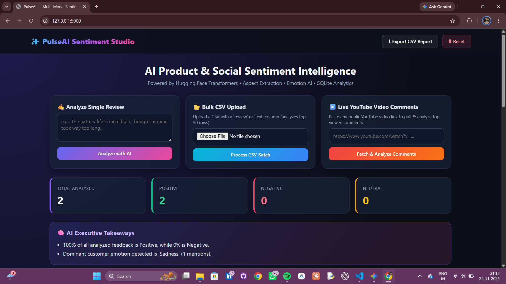

# ✨ PulseAI — Multi-Modal Sentiment & Emotion Intelligence Studio

An end-to-end AI-powered sentiment and emotion analytics web application built with **Python, Hugging Face Transformers, Flask, and SQLite**. Designed to analyze single product reviews, bulk CSV datasets, and live YouTube video comments with interactive visual reporting.



## 🚀 Key Features
- **Multi-Channel Ingestion:** Analyze individual reviews, upload bulk `.csv` files, or scrape live comments directly from public YouTube links.
- **Dual-Transformer AI Pipeline:**
  - **Sentiment Scoring:** Classifies feedback into *Positive, Negative, or Neutral* with confidence scores (`cardiffnlp/twitter-roberta-base-sentiment-latest`).
  - **Emotion Detection:** Identifies granular customer emotions such as *Joy, Anger, Sadness, Fear, and Surprise* (`j-hartmann/emotion-english-distilroberta-base`).
- **Aspect-Based Sentiment Extraction:** Automatically breaks down feedback across key product dimensions (*Quality, Price, Delivery, Performance, Support*).
- **Automated Executive Takeaways:** Generates plain-English summaries highlighting overall sentiment ratios, dominant emotions, and top product pain points.
- **Interactive Visual Dashboard & Export:** Features Chart.js sentiment/emotion graphs, dynamic Positive vs. Negative Word Clouds, persistent SQLite storage, and one-click CSV report export.

## 🛠️ Tech Stack
- **Backend:** Python, Flask
- **AI / NLP:** Hugging Face `transformers`, PyTorch (`torch`)
- **Database:** SQLite3
- **Data & Visualization:** Pandas, Chart.js, WordCloud, Matplotlib
- **Scraping:** `youtube-comment-downloader`

## ⚙️ How to Run Locally
1. **Clone the repository:**
   ```bash
   git clone [https://github.com/YOUR-USERNAME/ai-sentiment-analyzer.git](https://github.com/YOUR-USERNAME/ai-sentiment-analyzer.git)
   cd ai-sentiment-analyzer